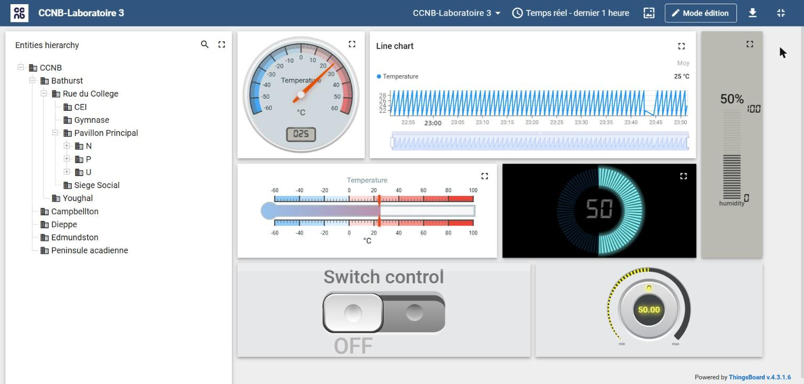

# 08 – ThingsBoard sur Raspberry Pi

Installation de **ThingsBoard Community Edition 4.3** sur un **Raspberry Pi** (Debian, PostgreSQL, Java 17) et création d'une solution de supervision IIoT pour un campus.



## Ce qui a été réalisé

- **Modélisation du campus** : actifs hiérarchisés (campus → bâtiments → pavillons → étages → locaux), reliés par des relations *Contains*, et 5 appareils de mesure.
- **Tableau de bord** : hiérarchie d'entités, jauges, thermomètre, graphique en temps réel, interrupteur et bouton rotatif.
- **Chaînes de règles** :
  - générateurs de télémétrie en **TBEL** ([generateurs-tbel](generateurs-tbel)) ;
  - calcul de **delta** entre deux mesures ;
  - création/effacement d'**alarmes** avec envoi de **courriel** (SMTP Gmail) – [chaines-de-regles](chaines-de-regles) ;
  - débogage des nœuds et consultation des **journaux d'audit**.
- **Commande à distance (RPC)** d'un ESP32 depuis le tableau de bord.

## Station ESP32 + DHT22 avec RPC

[esp32-dht22-rpc/esp32-dht22-rpc.ino](esp32-dht22-rpc/esp32-dht22-rpc.ino)

```
ESP32 ──MQTT 1883──► ThingsBoard      télémétrie : v1/devices/me/telemetry
ESP32 ◄──────────── ThingsBoard      commandes  : v1/devices/me/rpc/request/+
ESP32 ─────────────► ThingsBoard      réponses   : v1/devices/me/rpc/response/<id>
```

- Envoie température et humidité toutes les quelques secondes.
- S'abonne aux requêtes RPC et répond à `setState` / `getState` (interrupteur) et `setValue` / `getValue` (bouton rotatif) : la **LED intégrée (GPIO 2)** s'allume ou s'éteint depuis le tableau de bord.
- Le **jeton d'accès** de l'appareil (`TB_TOKEN`) est à remplacer par le vôtre.

## Importer la chaîne d'alarme

ThingsBoard → **Chaînes de règles** → **+** → **Importer une chaîne de règles** → choisir le fichier JSON.
Ce fichier est un exemple de la documentation ThingsBoard ; ses scripts JavaScript ont été convertis en **TBEL** lors de l'import.
