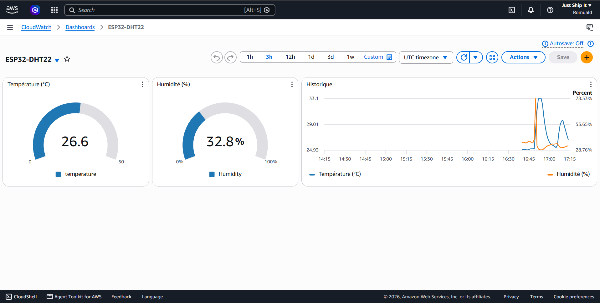

# 09 – AWS IoT Core + tableau de bord CloudWatch

Un ESP32 avec un capteur DHT22 envoie la température et l'humidité vers **Amazon Web Services**. Les mesures s'affichent dans un **tableau de bord CloudWatch** en temps réel.



## Architecture

```
ESP32 + DHT22 ──MQTT/TLS 8883 (certificats X.509)──► AWS IoT Core (sujet esp32/pub)
                                                          │ règle IoT (SQL)
                                                          ▼
                                     CloudWatch – métriques ESP32/temperature et ESP32/Humidity
                                                          ▼
                                     Tableau de bord ESP32-DHT22 (2 jauges + historique)
```

## Contenu

| Dossier / fichier | Rôle |
|---|---|
| [esp32-dht22-aws/esp32-dht22-aws.ino](esp32-dht22-aws/esp32-dht22-aws.ino) | Connexion Wi-Fi, connexion TLS à AWS IoT Core et publication de `{"humidity":…, "temperature":…}` sur `esp32/pub`. |
| [esp32-dht22-aws/secrets.h](esp32-dht22-aws/secrets.h) | **Modèle** à remplir : Wi-Fi, point de terminaison AWS, certificat CA, certificat et clé privée de l'appareil. |
| [regle-iot/esp32_vers_CloudWatch.json](regle-iot/esp32_vers_CloudWatch.json) | La règle IoT : requête SQL + 2 actions « CloudWatch metric ». |
| [tableau-de-bord-cloudwatch/ESP32-DHT22.json](tableau-de-bord-cloudwatch/ESP32-DHT22.json) | La source du tableau de bord (CloudWatch → Tableau de bord → Actions → Afficher/modifier la source). |

## Étapes réalisées

1. **AWS IoT Core** : création de l'objet, génération automatique du certificat, création d'une politique de sécurité attachée au certificat.
2. **ESP32** : certificats copiés dans `secrets.h`, connexion vérifiée dans le *Client de test MQTT*.
3. **Règle IoT** `SELECT temperature, humidity FROM 'esp32/pub'` avec un **rôle IAM** autorisant l'écriture dans CloudWatch.
4. **CloudWatch** : vérification des métriques dans l'espace de noms personnalisé `ESP32`, puis création du tableau de bord.

## Problème rencontré et résolu

Au départ, aucune métrique n'apparaissait dans CloudWatch, **sans aucun message d'erreur**. Les causes :
- les **unités** étaient écrites `none` et `percent` alors que CloudWatch exige exactement `None` et `Percent` ;
- la valeur `${Humidity}` ne correspondait pas à la clé `humidity` (en minuscules) du message JSON.

Après correction, les données sont arrivées dans CloudWatch.

> 💰 Cette configuration reste dans l'offre gratuite d'AWS (3 tableaux de bord et 10 métriques personnalisées gratuits).

**Base du code ESP32 :** [how2electronics – Connecting ESP32 to Amazon AWS IoT Core using MQTT](https://how2electronics.com/connecting-esp32-to-amazon-aws-iot-core-using-mqtt/), adapté (ArduinoJson 7, DHT22).
